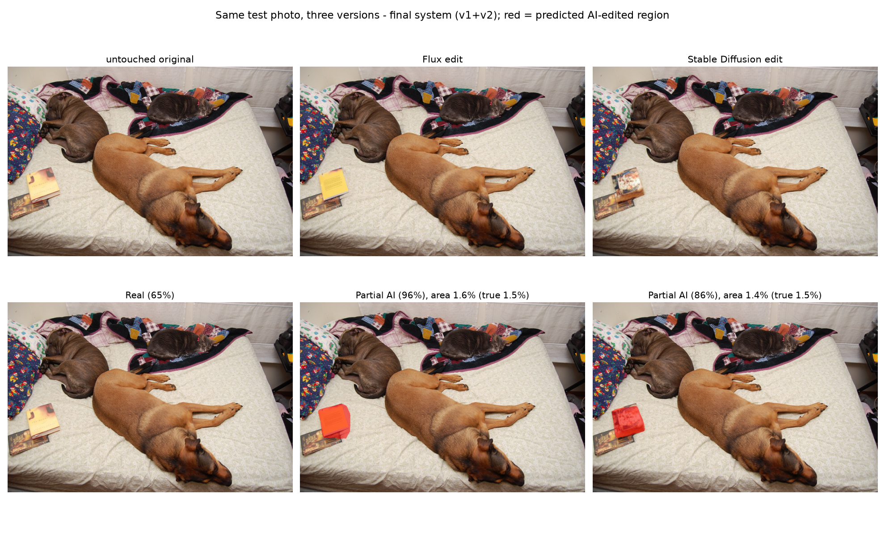
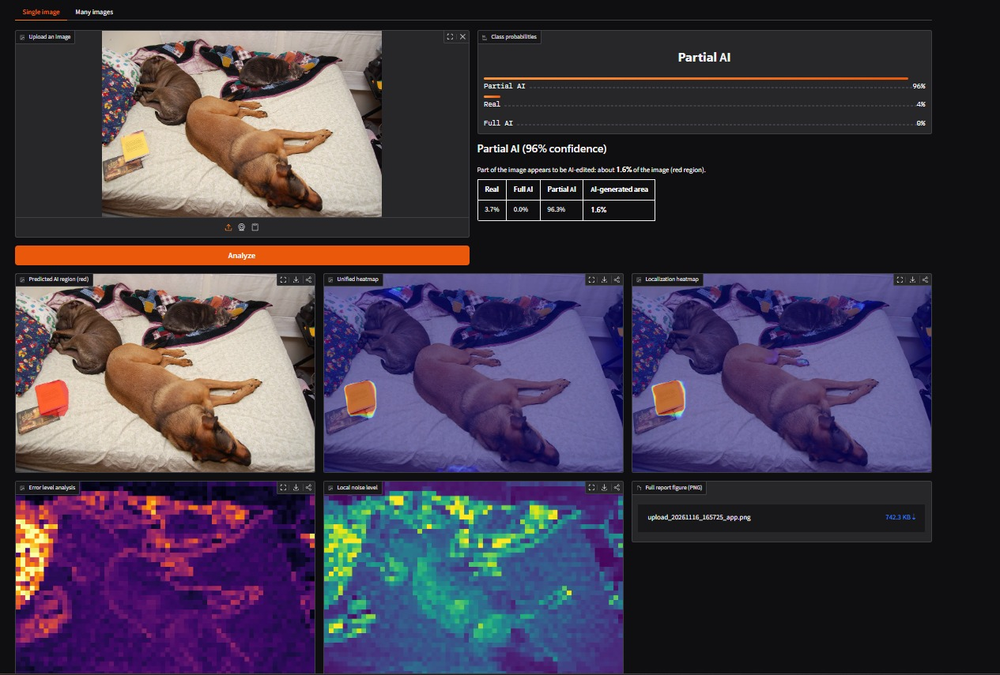

# AI Image Manipulation Detection

A framework to **identify, localize and quantify** AI manipulation in images: Real, Full AI or Partial AI.

Given any image, the system decides whether it is **Real**, **fully AI-generated (Full AI)** or **partly AI-edited (Partial AI)**.
For edited images it also **draws the edited region** and **estimates what percentage of the image is AI-generated**.
Only pixel content is used — no file metadata. A web app lets anyone upload images and see the results.



*One test photo: untouched (Real), Flux edit and Stable Diffusion edit of the book on the left. Red = predicted AI-edited region; predicted area 1.6% and 1.4% (true 1.5%).*

---

## Results (final system: v1 + v2 combined)

All numbers are on held-out test images. The test set is split **by source photo**, so no variant of a test photo is ever seen in training.

| Main test set (1,631 images) | Precision | Recall | F1 | Images |
|---|---|---|---|---|
| Real | 0.815 | 0.890 | 0.851 | 702 |
| Full AI | 0.971 | 0.996 | 0.983 | 500 |
| Partial AI | 0.809 | 0.662 | 0.728 | 429 |
| **Overall** | macro 0.865 | macro 0.849 | **macro 0.854** | **accuracy 0.863** |

| Generalisation (images never used in training) | v1 | v2 | **v1+v2 (final)** |
|---|---|---|---|
| Main test accuracy (1,631 images) | **86.9%** | 85.0% | 86.3% |
| Newer generators + second editing tool (530 images) | 39.2% | **72.5%** | 70.8% |
| Mask F1, Flux edits (main test) | **0.602** | 0.463 | 0.567 |
| Mask F1, Stable Diffusion 1.5 edits | 0.112 | **0.648** | 0.635 |
| SD 3.5 / Midjourney v6 / DALL·E 3 detected (never trained on) | 4% / 12% / 14% | 78% / 60% / 4% | 80% / 52% / 8% |

Localization of the v1 edit finder on verified segmentation masks: overall F1 **0.729**, pixel AUC 0.967, median AI-area error **0.79 percentage points**.

### Known limitations (measured)
- **Modern smartphone photos** are often flagged as AI: 45% of 20 held-out phone photos classified correctly (phone HDR / sharpening / AI enhancement is absent from the training data).
- **ChatGPT (OpenAI GPT Image) and DALL·E 3 images** are not detected (0 of 7 ChatGPT images labelled Full AI; DALL·E 3 8%).
- **Large edits** (background or outfit replacement) are not localised — training edits are small objects (median 1.5% of the image).
- **Small edits** are the main miss: 140 of 429 Partial AI test images are classified Real.

Fine-tuning on 63 own phone photos and 41 ChatGPT images (v3, notebook 17) did not fix these; far more data is needed (see *Future work*).

---

## How it works

```
image ─┬─ U-Net "unified" (v1) ──┐
       ├─ U-Net "edit finder" (v1)┤   12 heatmap statistics each      ┌─ Real / Full AI / Partial AI
       ├─ U-Net "unified" (v2) ──┤ ─────────────────────────────────► │   (logistic regression)
       └─ U-Net "edit finder" (v2)┘                                   └─ blended edit-finder heatmap
                                                                         → red mask + AI-area %
```

- **U-Net segmentation networks** (ImageNet-pretrained ResNet-34 encoder, `segmentation_models_pytorch`) predict, for every pixel, the probability that it is AI-generated.
  - *Unified model*: trained on all three classes (target 0 for Real, 1 for Full AI, the edit mask for Partial AI), with each edited photo's untouched original as a paired Real example.
  - *Edit finder (localization model)*: trained only on edited photos with **verified** masks.
- **Decision**: a logistic regression reads 12 statistics of each heatmap (share of pixels above 0.1–0.9, mean, std, max, percentiles, top-1% mean) and outputs the three class probabilities. Features, weighting, heatmap blend and thresholds are all chosen on the **validation** set.
- **v1** = trained on the original data; **v2** = fine-tuned with Stable Diffusion 2.1 / SDXL / SD 3 images and 600 Stable Diffusion inpainting edits; the **final system combines both**.
- **Forensic maps** (error level analysis, local noise) are shown in the app as visual hints only.

### What made the biggest difference
1. **Mask audit (notebook 08):** comparing each edited image with its original showed **28% of checkable masks point at a region that was never changed**. Training only on verified masks raised localization F1 from **0.51 to 0.73** on the same test images.
2. **Leak-free split:** the original random split put variants of the same photo in training and test; all final numbers use a split by source photo.
3. **No shortcuts:** random JPEG re-saving and rescaling for every class, and a JPEG re-save test, show the decision does not rely on file format.

---

## Repository structure

```
├── app.py                     Web app (Gradio): single image + batch mode
├── make_report_figures.py     Runs the final system on test images and saves report figures
├── status.py                  Progress check for long notebook runs
├── requirements.txt
├── notebooks/                 01–17, run in order (see below)
└── results/
    ├── figures/               Report figures and app screenshots
    ├── v2/                    v1 vs v2 vs v1+v2 vs v3 comparison tables and plots
    ├── ood/                   Out-of-distribution tests (new generators, SD vs Flux edits)
    └── unified/               Final hybrid (v1) test results
```

| Notebook | Purpose |
|---|---|
| `01_Feature_Extraction_15k` | 836 handcrafted forensic features + 768 DINOv2 features per image (baseline) |
| `02`–`05` (+ `04b`) | Baseline classifiers written from scratch: logistic regression, linear SVM, RBF SVM (random Fourier features), random forest |
| `06_Localization` | First small U-Net (superseded) |
| `07_Localization_Quantification` | Edit finder: pretrained ResNet-34 U-Net, native-resolution crops, AI-area estimation |
| `08_Mask_Audit` | Checks every mask against the original photo; finds 28% wrong masks |
| `09_Classifier_Ensemble` | Stacking ensemble of the four baseline classifiers |
| `10_Localization_Ensemble` | Ensemble of localization models (no gain) |
| `11_Test_Own_Images`, `12_Full_Pipeline_New_Image` | Full pipeline on new images; JPEG-shortcut and feature-reproduction checks |
| `13_Unified_Detector` | Unified model + **hybrid decision (v1)** |
| `14_OOD_Test` | Six newer generators (COCO_AI) and Stable Diffusion re-edits of test photos |
| `15_MultiGenerator_v2` | **v2**: fine-tuning with more generators and SD edits |
| `16_Combined_v1_v2` | **Final system**: v1 + v2 combined, chosen on validation |
| `17_Own_Images_v3` | v3 experiment with own phone photos and ChatGPT images (no gain) |

---

## Setup

Tested on Windows 11 with an NVIDIA RTX 4050 Laptop GPU (6 GB), Python 3.12; the notebooks also run on Google Colab.

```bat
python -m venv C:\aienv
C:\aienv\Scripts\activate
pip install torch torchvision --index-url https://download.pytorch.org/whl/cu130
pip install -r requirements.txt
```
Check the GPU: `python -c "import torch; print(torch.cuda.is_available())"` should print `True`.

### Data (not included — too large)
Place the data in one project folder (default `C:\AI_Image_Project`, or set the environment variable `AI_PROJECT_DIR`):

| Folder | Content |
|---|---|
| `COCO_5000/` | 5,000 real COCO photographs |
| `DiffusionDB_5000/` | 5,000 Stable Diffusion images from DiffusionDB |
| `Partial_AI_5000/` | 5,000 Flux-inpainted photos (`Manipulated/`), their masks (`Masks/`), untouched originals (`Original/`) and `pairs.csv` |

Notebooks 14–15 download extra data automatically from Hugging Face ([NasrinImp/COCO_AI](https://huggingface.co/datasets/NasrinImp/COCO_AI)) and generate Stable Diffusion 1.5 inpainting edits with `diffusers`.

### Trained models (not included — too large for GitHub)
Download from **[Google Drive link — add here]** and put them in `saved_models/localization/` inside the project folder. The final system (`--combo`) needs:
```
final_hybrid_combo_deploy.pkl
unified_Unet_resnet34_crop384_best.pth
unified_v2_resnet34_best.pth
Unet_resnet34_crop512_plusbbox_clean_deploy.pth
loc_v2_resnet34_deploy.pth
```

---

## Run the app

```bat
C:\aienv\Scripts\activate
cd /d C:\AI_Image_Project
python app.py --combo
```
Opens http://127.0.0.1:7860. Other options: `python app.py` (v1), `--v2`, `--v3`, `--share` (temporary public link), `--port 7861`.

- **Single image:** decision and class probabilities, AI-generated area %, predicted region in red, unified and localization heatmaps, error level analysis, noise map, and a downloadable report figure.
- **Many images:** a results table for a batch of uploads, also saved as CSV.



---

## Future work
1. Train with **GPT Image / ChatGPT images** (e.g. OpenFake, ShareGPT-4o-Image) and **hundreds of photos from many smartphones**.
2. Train the edit finder on **large edits** with masks (e.g. AUDITS, COCO-Inpaint, TGIF2).
3. Decide from **region-level evidence** (strongest heatmap blob) to catch edits under 1% of the image.
4. Robustness to social-media recompression, resizing and screenshots.

## Report
Full project report: **[link — add here]**

## Acknowledgements
COCO, DiffusionDB, COCO_AI (Defactify), Stable Diffusion (via `diffusers`), Flux inpainting data, `segmentation_models_pytorch`, DINOv2, Gradio.
Datasets keep their original licences.
